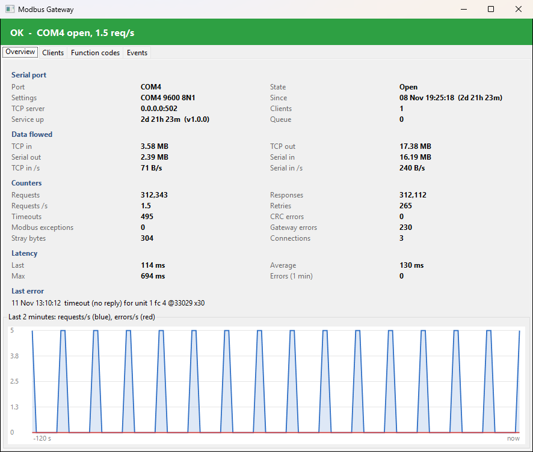
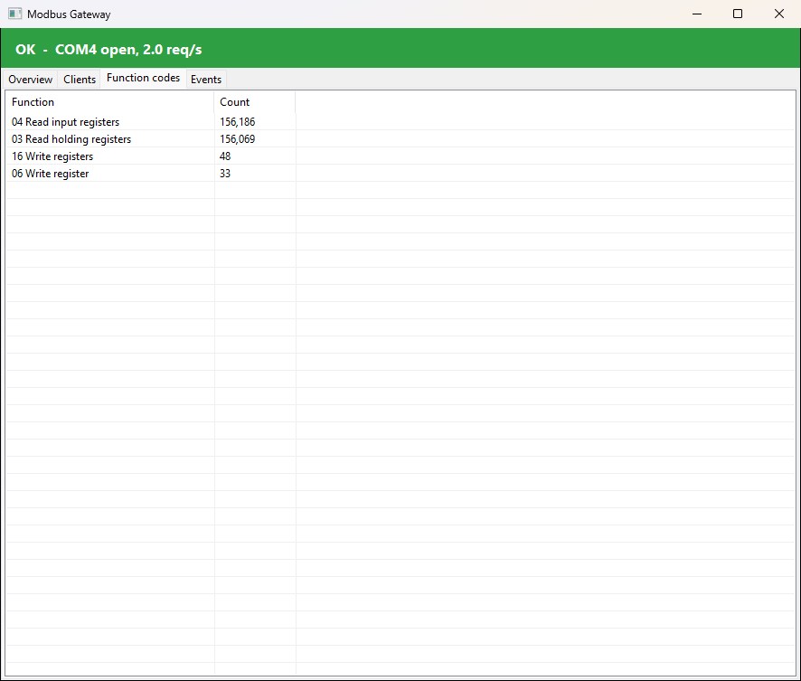

# Modbus Gateway

A Modbus TCP to Modbus RTU (RS-485) gateway for Windows.

I built this for when you have Home Assistant running as a VM under Hyper-V and you want to reach an inverter supported by the Solax Home Assistant plugin on a USB to RS-485 adapter, without USB passthrough to the VM.

```
Home Assistant (solax_modbus) --TCP 502--> ModbusGatewayService --COM4 9600 8N1--> Solis inverter
                                                 |
                                       127.0.0.1:5021/status --> ModbusGatewayTray (tray icon + status window)
```

## Parts

| Project | What it is |
|---|---|
| `src/ModbusGateway.Core` | The gateway engine: MBAP/RTU translation and CRC. Requests go through one queue because RS-485 is half-duplex. Reads are retried; writes never are. Also holds the stats and the log. |
| `src/ModbusGateway.Service` | Windows service `ModbusGateway`. Runs the engine and serves JSON status on `http://127.0.0.1:5021/status`. |
| `src/ModbusGateway.Tray` | Tray icon. Green: OK. Amber: errors in the last minute. Red: port closed. Grey: service not running. Double-click it for port status, connected clients, data flowed (TCP and serial bytes, plus rates), counters, latency, a 2-minute graph, function codes and recent events. |
| `tests/ModbusGateway.Tests` | Engine tests against a fake RTU slave. |

## Tray app

The status window, double-clicked from the tray icon, on a live gateway polled by Home Assistant:





## Behaviour

- **Replies are matched to requests.** The reply length comes from the function code, and the CRC is checked. Noise bytes before a reply are skipped.
- **Errors the gateway answers itself:**
  - Exception `0x0B` (target failed to respond) when the inverter doesn't answer.
  - Exception `0x0A` (path unavailable) while the COM port is closed.
- **Lost USB adapter:** the port is reopened every 5 s.
- **Logs:** daily files in `C:\ProgramData\ModbusGateway\logs`, kept for 30 days.

## Configuration

The config file is `C:\Program Files\ModbusGateway\appsettings.json`. Restart the service after you edit it.

| Setting | Default | Notes |
|---|---|---|
| `Serial.PortName` | `COM4` | |
| `Serial.BaudRate` | `9600` | |
| `Serial.Parity` | `None` | None, Even or Odd |
| `Serial.StopBits` | `One` | |
| `Tcp.Bind` | `0.0.0.0` | |
| `Tcp.Port` | `502` | |
| `ResponseTimeoutMs` | `1000` | |
| `InterFrameDelayMs` | `50` | The gap between frames. Some devices (Solis inverters, for one) need it. |
| `ReadRetries` | `1` | |
| `StatusPort` | `5021` | |

## Install

Download `ModbusGateway-v<version>-win-x64.zip` from [Releases](../../releases), unzip it, and follow the `INSTALL.md` inside it ([install/INSTALL.md](install/INSTALL.md)). In short, from an elevated PowerShell in the unzipped folder:

```powershell
Set-ExecutionPolicy -Scope Process Bypass -Force
Get-ChildItem | Unblock-File
.\install.ps1          # install, or upgrade in place (keeps an existing appsettings.json)
.\uninstall.ps1        # remove
```

`install.ps1` does the following:
- Creates the service with automatic start and restart on failure.
- Adds a firewall rule for the Modbus TCP port, from the local subnet only.
- Sets the tray app to start at login.

Close any other program using the COM port before installing. Only one program can open it at a time.

## Build

Needs the .NET 8 SDK or later.

```powershell
dotnet test
.\build-release.ps1    # tests, publishes both exes, zips them with the install scripts
```

The package lands in `dist\ModbusGateway-v<version>-win-x64.zip`. The version comes from `<Version>` in the Service `.csproj`; pass `-Version x.y.z` to override it.

To publish a GitHub release:

```powershell
gh release create v1.0.0 dist\ModbusGateway-v1.0.0-win-x64.zip --title "Modbus Gateway v1.0.0" --notes-file install\INSTALL.md
```

## Support

ModbusGateway is free and always will be. If it saves you time or money, you can buy me a coffee
towards keeping it going:

[](https://ko-fi.com/andyr82756)

Bug reports and reports from other hardware help just as much.

## Licence

[MIT](LICENSE). Provided as is, with no warranty. The gateway passes Modbus writes straight through to your device, so check what your client writes before you rely on it.
